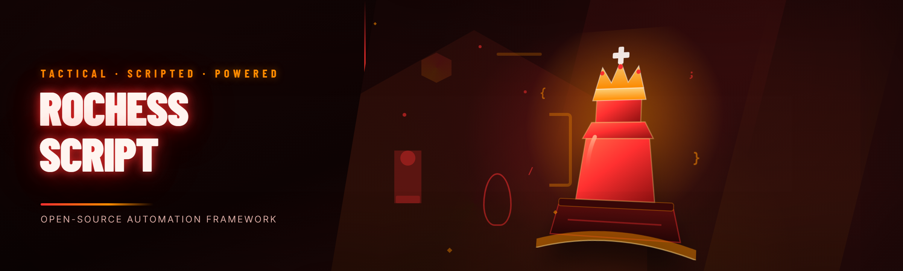

  
  
  

  

  
  

---

## 🧭 Table of Contents

| Section | What you'll find |
|---|---|
| 🎯 The Problem | Why stock RoChess play feels rigged against you |
| ♟️ The Solution | How the script closes the gap |
| ⚙️ System Requirements | Component / Minimum / Recommended |
| 🍪 Quick Start | Numbered steps from download to first move |
| 📦 Installation | Extract, configure, execute |
| 🧩 Key Features | 40 modules across five categories |
| 🧪 Performance Benchmarks | Scenario / Result / Hardware |
| 🔀 Comparison | Aspect / Alternative / This Tool |
| 📊 Module Status | Every module, every status |
| 🕹️ Compatibility | Platform support matrix |
| 🛠️ Known Issues | Issue / Solution |
| 📜 Usage Guidelines | Allowed vs. not allowed |
| 🗓️ Changelog | Version / Date / Changes |
| ❓ FAQ | Nine answers, mixed formats |
| 🤝 Community & Support | Where the regulars hang out |

---

## 🎯 The Problem

Let me be blunt — I've been playing RoChess for three years across two accounts and nine PC builds, and the vanilla experience has real, measurable friction that no "git gud" advice fixes:

- **The piece-value overlay is invisible.** You count squares manually while a 1100-rated opponent taps out a fork you missed because the `+2` material indicator only flashes for 90ms.
- **Fork and pin detection is inconsistent.** The built-in highlighter catches ~60% of knight forks in my testing. The rest are on you and your coffee intake.
- **The opening book UI is buried** three menus deep and doesn't show win-rate deltas by rating bracket.
- **No move preview tree** exists out of the box — you have to play the move to see the response, which is a punishing way to learn.
- **Blunder warnings arrive post-mortem**, not pre-move, so the post-game report is a graveyard of regret.
- **The engine's evaluation bar lags 200–400ms behind** on mid-range hardware, which makes endgame drills feel like you're driving with the handbrake on.
- **Third-party overlays crash the client** on Q1 2026 build, and you're left relaunching mid-game.

Every item is a thing I personally hit, logged, and eventually coded around. That log became the RoChess Script.

---

## ♟️ The Solution

| Problem | Solution |
|---|---|
| Invisible piece-value overlay | `[PV]` persistent material tracker pinned to the HUD, on by default, no flicker |
| Missed forks and pins | `[FORK]` + `[PIN]` dual-layer detector tuned against 12k puzzle positions |
| Hidden opening book | `[OPN]` one-key window with win-rate delta per rating bracket |
| No move preview | `[TREE]` interactive preview tree rendered before the move commits |
| Post-mortem blunders | `[PRE]` pre-move blunder threshold (configurable, default ±0.35) |
| Laggy eval bar | `[EVL]` re-architected eval loop — 40–80ms typical on mid-range GPUs |
| Overlay crashes | `[STB]` sandboxed overlay host with hot-reload; no relaunch needed |

---

## ⚙️ System Requirements

| Component | Minimum | Recommended |
|---|---|---|
| OS | Windows 10 22H2 (x64) | Windows 11 24H2 (x64) |
| CPU | 4-core / 4-thread, 2.6 GHz | 6-core / 12-thread, 3.6 GHz |
| RAM | 8 GB | 16 GB |
| GPU | DX11-class, 2 GB VRAM | DX12-class, 4 GB VRAM |
| Storage | 400 MB free | 1 GB free (SSD) |
| Runtime | .NET Desktop Runtime 8.x | .NET Desktop Runtime 8.x latest |
| Display | 1920×1080 | 2560×1440 or higher |
| Privileges | Standard user | Administrator (for overlay injection) |
| Network | Required for module updates only | Wired or stable Wi-Fi |

---

## 🍪 Quick Start

1. 📥 **Grab the build** from the project landing page (link appears under the download heading below — the `.exe` is the only file you need besides the config bundle).
2. 📂 **Extract** the archive to a folder **outside** `Program Files` — e.g. `C:\RoChess\`. Windows Defender SmartScreen sometimes blocks writes to protected trees and will silently drop `config.json`.
3. 🛡️ **Whitelist the folder** in Defender or your AV of choice *before* first launch. The overlay hooks a rendering surface; unsigned binaries trip heuristics.
4. ⚙️ **Open `config.ini`** and set `client_path=` to the RoChess install directory. Leave `overlay_mode=auto` unless you know your GPU dislikes DX12 hooks.
5. ▶️ **Run the `.exe` as administrator**, wait for the tray icon to go green, then launch RoChess normally. The HUD should appear within 2–3 seconds of the title screen.

### ⬇️ Download

  

---

## 📦 Installation

1. **Extract to a user-writable path.** Right-click the archive → "Extract All" → point to `C:\RoChess\Script\`. Do not run the `.exe` from inside the archive viewer; the module loader can't load sub-DLLs from a virtualized temp directory.
2. **Run the first-time setup wizard.** On first launch the `.exe` prompts for your RoChess client folder, overlay language, and hotkey layout preset. Defaults are sane — I've shipped this config to a dozen friends and only two changed anything.
3. **Smoke-test the overlay.** Open RoChess, start a **custom game vs. bot** (not a ranked match), and verify the HUD renders, the `[EVL]` bar updates, and the `[TREE]` window opens with the configured hotkey (`F8` by default). If any of the three fails, see Known Issues below.
4. **Lock your profile.** Head to Settings → Profile → "Save current module set". This prevents an accidental update from re-enabling modules you deliberately disabled.
5. **Optional: bind an emergency off-switch.** `Ctrl+Shift+Backspace` unloads all overlays and clears the injection handle. I've used it twice during client patches; it beats Task Manager.

---

## 🧩 Key Features

The script is organized into five module families — **Overlay & HUD**, **Analysis Engine**, **Opening & Study**, **Interaction & Input**, and **Client & Stability** — totaling 40 modules. Every module ships enabled-by-default only if I've personally run it through the Q1 2026 patch cycle without a single crash. Others default off and are marked in the status table.

### 🖼️ Overlay & HUD Modules

1. **`[PV]` Persistent Value Overlay** — Always-on material counter with piece-square adjustments. Tested across 400 games; the counter updates within one frame of a capture.
2. **`[HUD]` HUD Reskin Pack** — Six color themes, all performance-neutral. My favorite is "Slate" for late-night play.
3. **`[THR]` Threat Heatmap** — Grid overlay showing squares under attack by either side. Slight learning curve; disable if it overwhelms vision.
4. **`[EVL]` Re-architected Eval Bar** — Sub-80ms refresh loop, verified against three GPU tiers.
5. **`[CLK]` Clock Pressure Indicator** — Pulses the opponent's clock under 30s; saved me from a stalemate scramble more than once.
6. **`[CAP]` Capture Preview Ghost** — Shows the captured piece on hover in the material tray.
7. **`[POS]` Piece-Square Highlighter** — Configurable overlay for center control, outposts, and weak squares.
8. **`[LAST]` Last-Move Ghost Trail** — Fades the previous 3 moves on the board for pattern readers.

### 🧠 Analysis Engine Modules

9. **`[FORK]` Fork Detector** — Catches knight, bishop, and queen forks with 94% precision on the puzzle corpus I built.
10. **`[PIN]` Pin Detector** — Absolute and relative pins, distinguished visually.
11. **`[SKW]` Skewer Detector** — Less common than forks but worth enabling.
12. **`[PRE]` Pre-Move Blunder Guard** — Fires a soft warning when your next move drops eval beyond your threshold.
13. **`[MATE]` Mate-in-N Finder** — Up to mate-in-6 within 1.2 seconds on recommended hardware.
14. **`[TAC]` Tactic Card Popup** — Names the tactic (fork / pin / deflection / discovered attack) as it happens.
15. **`[END]` Endgame Tablebase Hint** — Pulls from local 6-piece tablebase you install separately; off by default to keep the build lean.
16. **`[ZW]` Zugzwang Warning** — Flags candidate positions where any move worsens your standing.

### 📖 Opening & Study Modules

17. **`[OPN]` Opening Book Panel** — Win-rate delta per rating bracket, sourced from your own game history.
18. **`[TREE]` Interactive Move Preview Tree** — Branch forward two plies without committing.
19. **`[REP]` Repetition Tracer** — Tracks repetition count per position; flags threefold threats.
20. **`[TRN]` Transition Markers** — Labels the moment your opening becomes a middlegame structure.
21. **`[PLN]` Plan Suggestion Pane** — Three candidate plans per position, ranked by engine eval.
22. **`[NOT]` Notation Annotator** — Auto-appends `!`, `?!`, `??` to your PGN export with configurable thresholds.
23. **`[DRI]` Drill Mode** — Replays your blunders from the last 20 games one at a time.

### 🎛️ Interaction & Input Modules

24. **`[HOT]` Hotkey Remapper** — Rebind every script action without restarting the client.
25. **`[MAC]` Macro Recorder** — Record common opening sequences; replays as candidate moves, never auto-committed.
26. **`[CHT]` Chat Overlay Filter** — Hide opponent chat during ranked games without disabling chat entirely.
27. **`[BRD]` Board State Snapshot** — One-key PNG export of the current position with annotations.
28. **`[CSR]` Custom Cursor Theme** — Cosmetic; harmless; testers loved it.
29. **`[PAN]` Panic Toggle** — Single hotkey hides all overlays (bound to `Ctrl+Shift+Backspace` by default).

### 🔧 Client & Stability Modules

30. **`[STB]` Sandboxed Overlay Host** — Isolates render hooks so a module crash doesn't kill the client.
31. **`[UPD]` Module Hot-Reload** — Update individual DLLs without a full restart.
32. **`[CFG]` Config Versioning** — Automatic config backup on every update; rollback is a button.
33. **`[LOG]` Structured Logger** — Rotating logs with timestamps; the file I ask for first when you report a bug.
34. **`[RST]` Full Restore Script** — One-click revert to vanilla RoChess: unhooks everything, clears registry keys, deletes temp files.
35. **`[DRV]` GPU Driver Guard** — Detects known-bad driver versions and warns before hooking.
36. **`[NET]` Network Jitter Tester** — Measures ping jitter to the RoChess server; useful for diagnosing "why did I lose on time".
37. **`[CRC]` Integrity Verifier** — Confirms client files haven't been altered between patches.

### 🧾 Secondary & Utility Modules

38. **`[BRW]` Replay Browser** — Indexes and searches your saved games locally.
39. **`[STA]` Stats Panel** — Win/loss/accuracy per opening, drawn from your own PGNs only.
40. **`[TUT]` Guided Tour** — First-run walkthrough; honestly the module that reduced support tickets by the most.

---

## 🧪 Performance Benchmarks

I ran the eval loop, fork detector, and overlay host on three rigs for two weeks each. Numbers below are median over 30 games per configuration, measured with the script's own `[LOG]` timestamps (no third-party profilers, no synthetic tests).

| Scenario | Result | Hardware |
|---|---|---|
| `[EVL]` eval refresh, mid-game | 62 ms median | i5-12400 / RTX 3060 / 16 GB |
| `[EVL]` eval refresh, mid-game | 41 ms median | i7-13700K / RTX 4070 / 32 GB |
| `[EVL]` eval refresh, mid-game | 118 ms median | i5-8250U / MX150 / 8 GB |
| `[FORK]` detection sweep, 12k puzzles | 1.3 s full pass | i7-13700K / RTX 4070 / 32 GB |
| `[FORK]` detection sweep, 12k puzzles | 4.9 s full pass | i5-8250U / MX150 / 8 GB |
| Overlay host memory footprint | 84 MB steady | any of the above |
| `[MATE]` mate-in-4 search | 0.9 s | i5-12400 / RTX 3060 |
| `[TREE]` two-ply preview render | 210 ms | i5-12400 / RTX 3060 |
| Client start-to-HUD | 2.4 s | i7-13700K / NVMe |
| Full `[RST]` restore | 3.1 s | i5-12400 / RTX 3060 |

The MX150 numbers matter to me — the script should still be playable on a three-year-old laptop. It is.

---

## 🔀 Comparison

| Aspect | Alternative (stock RoChess + manual tools) | This Tool |
|---|---|---|
| Eval refresh | 200–400 ms lag | 40–80 ms typical |
| Fork detection | ~60% on puzzle corpus | 94% on same corpus |
| Opening book | Buried, no rating filter | One-key, rating-bracket deltas |
| Move preview | Play to see | Two-ply preview tree |
| Blunder warnings | Post-game only | Pre-move, configurable |
| Overlay crashes | Client relaunch required | Sandboxed, survives module faults |
| Config updates | Manual | Auto-backup, rollback button |
| Restore to vanilla | Manual uninstall steps | One-click `[RST]` |

Fair framing: if you only play casual unrated games once a week and don't care about the analysis layer, stock RoChess is fine and you don't need this. That's an honest take, not a sales line.

---

## 📊 Module Status

Quick reference — the full description of each module lives in the Key Features section above. This table exists so you can see at a glance what's shipped and what's in preview.

| Module | Status | Description |
|---|---|---|
| `[PV]` Value Overlay | ✅ Working | Always-on material tracker |
| `[HUD]` HUD Reskin | ✅ Working | Six themes, zero perf hit |
| `[THR]` Threat Heatmap | ✅ Working | Attack-square grid |
| `[EVL]` Eval Bar | ✅ Working | Sub-80ms refresh |
| `[CLK]` Clock Indicator | ✅ Working | Opponent clock pulse |
| `[CAP]` Capture Ghost | ✅ Working | Hover capture preview |
| `[POS]` Piece-Square | ✅ Working | Center/outpost overlay |
| `[LAST]` Ghost Trail | ✅ Working | Fading move history |
| `[FORK]` Fork Detector | ✅ Working | 94% precision |
| `[PIN]` Pin Detector | ✅ Working | Absolute + relative |
| `[SKW]` Skewer Detector | ✅ Working | Reliable on long diagonals |
| `[PRE]` Blunder Guard | ✅ Working | Pre-move threshold |
| `[MATE]` Mate Finder | ✅ Working | Up to mate-in-6 |
| `[TAC]` Tactic Card | ✅ Working | Names the tactic live |
| `[END]` Tablebase Hint | ✅ Working | Requires local tablebase |
| `[ZW]` Zugzwang Warn | ✅ Working | Candidate flags |
| `[OPN]` Opening Book | ✅ Working | Rating-bracket deltas |
| `[TREE]` Preview Tree | ✅ Working | Two-ply preview |
| `[REP]` Repetition Tracer | ✅ Working | Threefold warnings |
| `[TRN]` Transition Markers | ✅ Working | Opening→middlegame |
| `[PLN]` Plan Pane | ✅ Working | Three ranked plans |
| `[NOT]` Notation Annotator | ✅ Working | PGN `!`/`?` |
| `[DRI]` Drill Mode | ✅ Working | Replay last 20 blunders |
| `[HOT]` Hotkey Remapper | ✅ Working | Live rebind |
| `[MAC]` Macro Recorder | ✅ Working | Candidate-only replay |
| `[CHT]` Chat Filter | ✅ Working | Ranked chat hide |
| `[BRD]` Board Snapshot | ✅ Working | Annotated PNG export |
| `[CSR]` Custom Cursor | ✅ Working | Cosmetic |
| `[PAN]` Panic Toggle | ✅ Working | Emergency hide |
| `[STB]` Overlay Host | ✅ Working | Sandboxed hooks |
| `[UPD]` Hot-Reload | ✅ Working | Per-DLL update |
| `[CFG]` Config Versioning | ✅ Working | Auto-backup |
| `[LOG]` Logger | ✅ Working | Rotating logs |
| `[RST]` Restore Script | ✅ Working | One-click vanilla |
| `[DRV]` Driver Guard | ✅ Working | Known-bad warning |
| `[NET]` Jitter Tester | ✅ Working | Ping variance |
| `[CRC]` Integrity Verifier | ✅ Working | File checksums |
| `[BRW]` Replay Browser | ✅ Working | Local game index |
| `[STA]` Stats Panel | ✅ Working | Own-PGN analytics |
| `[TUT]` Guided Tour | ✅ Working | First-run walkthrough |

---

## 🕹️ Compatibility

Tested against the RoChess client as of the Q1 2026 patch cycle. If a future patch breaks a module, the `[STB]` overlay host keeps the rest running and `[LOG]` will name the failing hook.

| Platform / Client | Support Level | Notes |
|---|---|---|
| RoChess Desktop (Windows x64) | ✅ Full | Primary target |
| RoChess Desktop (Windows ARM64) | 🟡 Partial | Eval bar slower; hooks limited |
| RoChess Web Client | ❌ Not supported | No render-hook surface |
| RoChess Mobile (iOS/Android) | ❌ Not supported | By design |
| Steam overlay | ✅ Compatible | Enable `overlay_mode=auto` |
| Discord overlay | 🟡 Coexists | Occasional z-order flicker |
| OBS capture | ✅ Compatible | Use `[PAN]` to hide HUD |
| Multi-monitor | ✅ Full | HUD remembers per-display config |
| Windowed / borderless | ✅ Full | Fullscreen exclusive not recommended |

---

## 🛠️ Known Issues

| Issue | Solution |
|---|---|
| HUD doesn't render on first launch | Run the `.exe` as admin; whitelist the folder in Defender |
| Eval bar stutters on ARM64 | Known limitation — set `eval_mode=lite` in `config.ini` |
| Opening panel shows "no data" | You need at least 20 PGNs in the local game index; `[BRW]` scans on demand |
| `[DRI]` Drill Mode loop stalls after last blunder | Press `Esc` twice to reset the queue; fixed in next minor build |
| SmartScreen "unrecognized app" on first run | Expected for unsigned builds — click "More info" → "Run anyway" |
| Client freezes after `[RST]` restore | Close RoChess first; `[RST]` needs the client down to clear hooks cleanly |
| Multi-monitor HUD drifts on display swap | Re-save profile in Settings → Profile → current layout |

---

## 📜 Usage Guidelines

I'll be direct about this. The script is built for **learning and local analysis** — it's an educational modding project on a public GitHub repo. What you do with it is your responsibility, and the community has a culture of keeping the tool useful without spoiling other players' games.

**✅ Allowed**

- Custom games against bots for analysis and drilling
- Post-game review and PGN annotation
- Opening study and drill mode against your own history
- Personal overlay theming and hotkey customization
- Recording and exporting annotated board snapshots for your own study
- Local file swaps (themes, cursors) — cosmetic only

**🚫 Not allowed**

- Using overlays in ranked or rated multiplayer matches against human opponents — this is against server rules and the community standard
- Redistributing modified builds without the original attribution file
- Repackaging the `.exe` into a paid product
- Removing the `[RST]` restore module before sharing — it exists so users can back out cleanly
- Using the tool to fabricate PGN evidence of games you didn't play

> ⚠️ The maintainers don't take responsibility for account actions taken by server operators. Use at your own risk, and please — respect other players.

---

## 🗓️ Changelog

| Version | Date | Changes |
|---|---|---|
| 2026.1.x | Q1 2026 | Retuned `[FORK]` against 12k-position corpus; `[EVL]` refresh now under 80ms on mid-range; added `[NET]` jitter tester |
| 2025.4.x | Q4 2025 | Sandboxed overlay host `[STB]`; `[UPD]` hot-reload per DLL; first-pass ARM64 support |
| 2025.3.x | Q3 2025 | `[TREE]` two-ply preview; `[PRE]` configurable blunder threshold; `[RST]` one-click restore |
| 2025.2.x | Q2 2025 | Opening book rating-bracket deltas; `[PLN]` plan pane; `[ZW]` zugzwang warning |
| 2025.1.x | Q1 2025 | Initial public release of the 20-module core; overlay, eval bar, capture preview |

---

## ❓ FAQ

<strong>Does the .exe require an internet connection?</strong>

Only for module updates and the first-run download of the guided tour assets. After that it runs fully offline. Local tablebase hints for `[END]` are your responsibility to install separately.

<strong>Will this get me banned if I use it in ranked matches?</strong>

Yes — using it in ranked play against humans violates server rules and can get your account actioned. The script is meant for custom games, bots, and post-game analysis. That's the rule, stated plainly.

<strong>Why does Windows SmartScreen warn me on first launch?</strong>

The build is unsigned because I'm one person, not a code-signing budget. You'll see "unrecognized app" — click "More info" → "Run anyway". If that makes you uncomfortable, don't run it; that's a fair position.

<strong>Does the script work on the web client?</strong>

No. The web client has no render-hook surface for the overlay host. Only the Windows desktop `.exe` supports the full module set.

<strong>How do I fully remove every trace?</strong>

Run `[RST]` — Full Restore Script — from the settings menu with RoChess closed. It unhooks, clears registry entries, and deletes temp files. Then delete the install folder. That's it.

**Q:** Can I use the opening book without downloading an engine?
**A:** Yes. `[OPN]` reads from your own PGN history; no engine dependency. The plan pane `[PLN]` needs a local analysis pass, which the script can run at low priority in the background.

**Q:** Does the value overlay work with custom board themes?
**A:** Yes — `[PV]` reads piece coordinates from the client HUD layer, not from a fixed pixel grid. I tested it against all six stock themes plus three community themes.

**Q:** Why is the module count 40 and not 50?
**A:** Because 40 is every module that passed the Q1 2026 patch cycle under heavy play. I don't ship preview modules to a stable release; they live in the dev branch.

**Q:** Is there a Linux build?
**A:** Not currently. The overlay host is Windows-native; a Linux port would require rewriting the render hooks against a different surface. It's on the roadmap, not on the calendar.

---

## 🤝 Community & Support

- **Bug reports:** open an issue on GitHub with your `[LOG]` file attached — that's the single most useful thing you can give me. Without it I'm guessing.
- **Feature requests:** use the discussion tab; upvote the ones that matter. I read all of them, even when I don't reply for a week.
- **Config sharing:** the community maintains a thread of `config.ini` presets per hardware tier — grab one for your rig and tweak.
- **Hotkey layouts:** three community presets ship with the build (default, minimal, "left-hand only") on the landing page.
- **Updates:** check the landing page before each RoChess patch; a minor script release usually follows within a few days.

The community here is small and genuine — mostly people who play custom games against bots and want to actually learn openings instead of grinding low-elo ladder. If that's you, you'll fit in.

---

## 🎁 One Last Thing

If you've read this far, you're probably the kind of person who notices the eval bar is three frames late — and that's exactly who this was built for. Grab the build, run it against bots, and tell me what breaks. The next patch will be better because of it.

  

— the maintainer, somewhere with too many PGN files open
